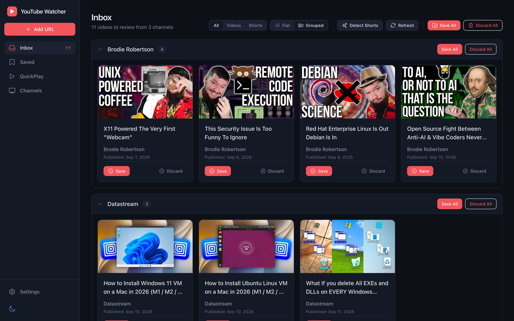

# YouTube-Watcher

A self-hosted app for keeping up with YouTube channels without the YouTube homepage. It checks the channels you follow for new uploads, puts them in an inbox for you to save or discard, and keeps the ones you save in a watch-later library.



## What it does

- **Follow channels without an API key.** New uploads are read from YouTube's RSS feeds, on demand or on a schedule.
- **Triage an inbox.** Save or discard each new video, or a whole channel's worth at once. Shorts are detected automatically and can be filtered out.
- **Keep a watch-later library.** Filter by channel, sort by date, pick a layout, and play any selection as a YouTube playlist.
- **QuickPlay.** Play your 50 oldest saved videos or Shorts in one click, then clear that batch to load the next.
- **Save any video directly.** Paste a YouTube link to add it to your library without following the channel.
- **Recover mistakes.** Removed videos go to Recently Deleted, where they can be restored.
- **Back up and move your data.** Scheduled backups, plus JSON import and export.
- **Use it anywhere.** Works on desktop and phone, and can be installed as an app (PWA). Login is optional.

## Run it

You need Docker with Docker Compose.

1. Create a folder with this `docker-compose.yml`:

   ```yaml
   services:
     app:
       image: ghcr.io/thejudge22/youtube-watcher:latest
       ports:
         - "38000:8000"
       volumes:
         - ./data:/app/data
       env_file:
         - .env
       user: "1000:1000"
       restart: unless-stopped
   ```

2. Download [`.env.example`](.env.example) into the same folder and rename it to `.env`.
3. Start it:

   ```bash
   docker compose up -d
   ```

4. Open http://localhost:38000.

Your data lives in `./data` (the database, backups and the login secret). To update, run `docker compose pull` and then `docker compose up -d`. To stay on a specific release instead of `:latest`, use a tag such as `:v2026-10-21`.

**Exposing it beyond your own machine?** Turn on login first. See [Configuration](docs/configuration.md#authentication).

### Run from source

```bash
git clone https://github.com/thejudge22/youtube-watcher.git
cd youtube-watcher
cp .env.example .env
docker compose -f docker-compose-local.yml up --build
```

Then open http://localhost:38000.

## Use it

1. **Add channels.** Open **Channels**, choose **Add Channel**, and paste a channel link (`@handle`, `/channel/…` or `/c/…`).
2. **Check the Inbox.** New videos appear here. Use **Refresh** to check now, or turn on auto-refresh in **Settings**.
3. **Save or discard.** Saved videos go to **Saved**; discarded ones go to Recently Deleted.
4. **Watch.** Open a video from **Saved**, select several and choose **Play as Playlist**, or use **QuickPlay**.

The [User Guide](docs/user-guide.md) covers every page, supported links, backups and import/export.

## More documentation

- [User Guide](docs/user-guide.md): pages and features in detail, supported URL formats, backups, import and export
- [Configuration](docs/configuration.md): environment variables, login, API keys, security options
- [Developer Guide](DEVELOPER_GUIDE.md): architecture, local development, tests and releases

## License

MIT
